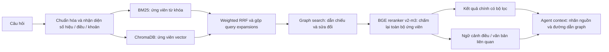

# Hybrid retrieval, BGE reranking và legal graph



## Cài đặt và chạy

```powershell
.\.venv\Scripts\python -m pip install -r requirements-rerank.txt
.\.venv\Scripts\python build_graph.py
.\.venv\Scripts\python warmup_reranker.py --smoke-test
.\.venv\Scripts\python search.py "Thủ tục cấp giấy chứng nhận quyền sử dụng đất" --config src/embedding/config.openai.yaml --retrieval-config config/retrieval.yaml
```

Search cần collection đã ingest và API key khi dùng embedding OpenAI. BGE reranker là model local, độc lập với model embedding. Thay reranker không cần tạo lại vector. Trọng số được cache ở `data/models`; `device: null` tự chọn CUDA nếu PyTorch hỗ trợ và có GPU, nếu không dùng CPU. Có thể đặt `cpu` hoặc `cuda` rõ ràng. `dtype: auto` chọn FP16 trên CUDA và FP32 trên CPU; cũng nhận `float16`, `float32`, `bfloat16`. Batch mặc định 1 và cửa sổ 1024 token để phù hợp GPU 4 GB; đoạn dài vẫn được chấm theo nhiều cửa sổ.

Với Windows/Python 3.13 và GPU NVIDIA hỗ trợ CUDA 12.8, cài bản PyTorch CUDA từ kho chính thức trước khi chạy reranker:

```powershell
.\.venv\Scripts\python -m pip install torch==2.11.0+cu128 --index-url https://download.pytorch.org/whl/cu128
.\.venv\Scripts\python -c "import torch; print(torch.__version__, torch.cuda.is_available())"
```

Sau khi cache đủ model, có thể kiểm tra hoàn toàn local, không gọi OpenAI hoặc tải model:

```powershell
.\.venv\Scripts\python warmup_reranker.py --local-only --smoke-test --output docs/reranker_validation.json
.\.venv\Scripts\python chat.py
```

Lệnh warmup báo thiết bị, dtype, thời gian tải model và điểm của hai đoạn tiếng Việt; kiểm thử chỉ đạt khi đoạn liên quan được xếp trước đoạn không liên quan. Khi đã bật rerank, không thêm `--no-rerank` vào lệnh chat. Tham khảo [cài đặt PyTorch chính thức](https://pytorch.org/get-started/locally/).

Nếu tải qua Xet lỗi mạng, dùng HTTPS chuẩn và tải lại các file dở:

```powershell
.\.venv\Scripts\python warmup_reranker.py --http-download --force-download --smoke-test
```

Warmup có giới hạn tổng thời gian 900 giây, kể cả khi transport/lock tải file bị treo; tăng `--timeout-seconds` nếu đường truyền chậm. Sau một lượt timeout có thể chạy lại cùng lệnh không có `--force-download` để tận dụng cache đã có.

Runtime mặc định `reranker.local_files_only: true`: API giải quyết model ID thành đường dẫn snapshot trong cache trước khi nạp, tránh các lần hỏi metadata online của AutoProcessor. API báo lỗi 503 có hướng dẫn nếu thiếu model, không treo request để tải trọng số. Lệnh warmup chủ động cho phép tải model trước. API không tự bỏ qua bước rerank. Muốn chạy so sánh không rerank hoặc không graph, tắt rõ ràng:

```powershell
.\.venv\Scripts\python search.py "Thủ tục cấp giấy chứng nhận" --config src/embedding/config.openai.yaml --no-rerank --no-graph
```

## Cấu hình và điểm số

[retrieval.yaml](../config/retrieval.yaml) mặc định lấy tối đa 50 ứng viên vector, 50 ứng viên BM25 cho mỗi biến thể câu hỏi, rồi giữ tối đa 80 ứng viên hybrid (mở rộng ngân sách khi `top_k` lớn). BM25 truy vấn trên nội dung và metadata trích dẫn. Hai nhánh chạy độc lập; chunk không được vector tìm ra vẫn có thể được BM25 đưa vào tập ứng viên.

Điểm RRF là tổng `weight / (rrf_k + rank)`. Chúng được giữ ở `retrieval_score` sau reranking. `rerank_score`/`score` là điểm của cross-encoder; không xem đó là xác suất đúng về pháp lý hay so trực tiếp với điểm RRF.

Reranker nhận cặp câu hỏi và đoạn luật có citation, chấm lại cả ứng viên hybrid lẫn graph **trước khi cắt top kết quả**. Đoạn dài được chia cửa sổ token có overlap, lấy điểm cao nhất trong các cửa sổ; không âm thầm bỏ phần cuối. `max_length: 1024` là ngân sách mỗi cặp, có thể tăng tới 8192 với BGE v2-m3 khi đủ bộ nhớ. Nếu câu hỏi không còn chỗ cho đoạn văn, chương trình báo lỗi.

Tài liệu model và API sử dụng: [BGE model card](https://huggingface.co/BAAI/bge-reranker-v2-m3), [Sentence Transformers CrossEncoder](https://www.sbert.net/docs/package_reference/cross_encoder/model.html).

## Graph và dẫn chiếu giữa các văn bản

Graph dùng NetworkX `MultiDiGraph`, lưu JSON ở `data/graph/legal_graph.json`. Các node gồm văn bản, điều và chunk. Cạnh `contains` thể hiện cấu trúc; `cites` thể hiện dẫn chiếu; `amends` thể hiện câu chữ sửa đổi/bổ sung/bãi bỏ được nhận diện. Mỗi cạnh dẫn chiếu giữ `evidence`, đơn vị nguồn, cách xác định văn bản đích và khoản đích nếu có.

Ví dụ `khoản 7 Điều 2 Nghị định 2/2024/NĐ-CP` gắn đúng số hiệu, điều và khoản. Không tạo tích chéo mọi điều với mọi số hiệu trong đoạn văn. Dẫn chiếu chưa xác định được văn bản hoặc chưa có điều đích trong corpus được lưu ở `unresolved`, không tự chuyển về văn bản nguồn. Trong văn bản sửa đổi, tên văn bản đích từ tiêu đề điều/chương được lưu ở `document_context` nếu dùng để giải quyết dẫn chiếu rút gọn.

Graph search đi cả chiều dẫn chiếu và chiều ngược để tìm văn bản sửa đổi/điều dẫn tới điều đang xem. Không đi qua cạnh `contains` để mở toàn bộ văn bản. Mặc định: 8 seed chunk, 2 bước, tối đa 20 điều mới, 40 chunk mới, 2 chunk mỗi điều và 8 chunk ngữ cảnh cuối. Khoản được dẫn chiếu cụ thể được ưu tiên; BM25 chọn đoạn phù hợp với câu hỏi trong điều dài.

Khi chạy `/search`, graph expansion kiểm tra hash seed và đối chiếu chunk đích với ChromaDB, loại nội dung thiếu hoặc cũ. Bộ lọc số hiệu/điều/khoản của câu hỏi vẫn áp dụng cho `results`; bằng chứng từ điều/văn bản khác nằm ở `related_context`. `retrieval.graph.paths` giữ lý do mở rộng.

Chạy lại `build_graph.py` sau khi sửa corpus; pipeline prepare và embedding-only cũng dựng lại graph mặc định. Nếu đổi `graph.path`, dùng `build_graph.py --output <đường-dẫn>` tương ứng.

## Hai công cụ cho agent

1. `POST /search` với `query`, `top_k`: tìm câu hỏi bằng hybrid, mở graph, rerank và trả bằng chứng.
2. `POST /graph/search` với `doc_id`, `article_no` dạng chuỗi, `max_hops`, `query` tùy chọn: duyệt graph từ một điều cụ thể. Không gọi embedding; chỉ rerank nếu có `query`. Công cụ này đọc corpus của graph và ghi `collection_verified: false`, không yêu cầu corpus đó đã có trong collection vector.

```powershell
.\.venv\Scripts\python graph_search.py --doc-id 31_2024_QH15 --article 138 --max-hops 2
.\.venv\Scripts\python graph_search.py --doc-id 31_2024_QH15 --article 138 --query "Hồ sơ cấp giấy chứng nhận"
```

Trong Python, dùng `LegalRetriever.retrieve(...)` và `LegalRetriever.graph_search(...)`. API giữ một retriever dùng chung trong lifespan, tái sử dụng model, graph và cache BM25. Đặt `RETRIEVAL_CONFIG=config/retrieval.yaml` trong `.env` để chọn cấu hình.

`agent_context.text` có nhãn `[S1]` cho kết quả chính, `[G1]` cho ngữ cảnh liên quan; `agent_context.sources` ánh xạ nhãn sang citation, URL, chunk ID và đường dẫn graph. Giới hạn ngữ cảnh mặc định 24.000 ký tự; bỏ nguyên đoạn vượt ngân sách và trả `truncated: true`. Agent nên chỉ dẫn những nhãn thực sự xuất hiện trong ngữ cảnh, nêu thiếu bằng chứng khi chưa đủ, và phân biệt văn bản gốc với văn bản sửa đổi.

Cạnh graph được trích xuất bằng quy tắc và chưa xác nhận hiệu lực theo thời điểm (`legal_effect_verified: false`). Graph hỗ trợ tìm bằng chứng, chưa tự hợp nhất văn bản, giải quyết xung đột luật hay chứng minh đáp án cuối đúng hơn. Cần tập câu hỏi pháp lý có đáp án và trích dẫn chuẩn để đo Recall/MRR/nDCG và độ chính xác câu trả lời.
